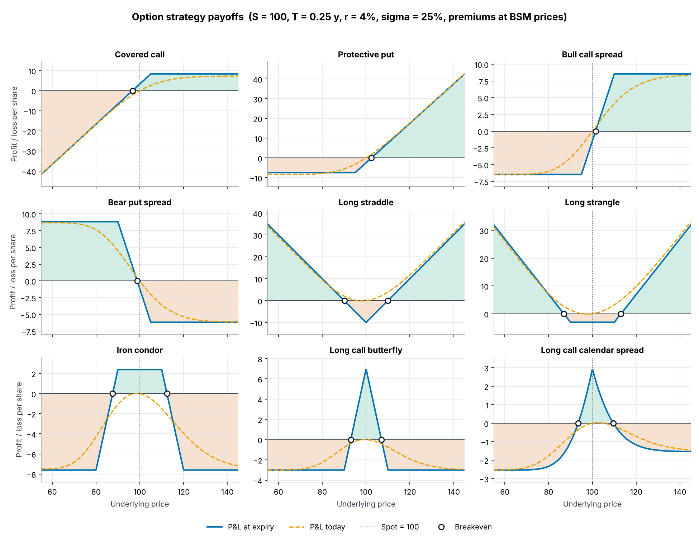
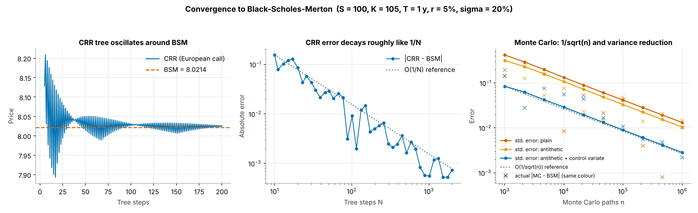
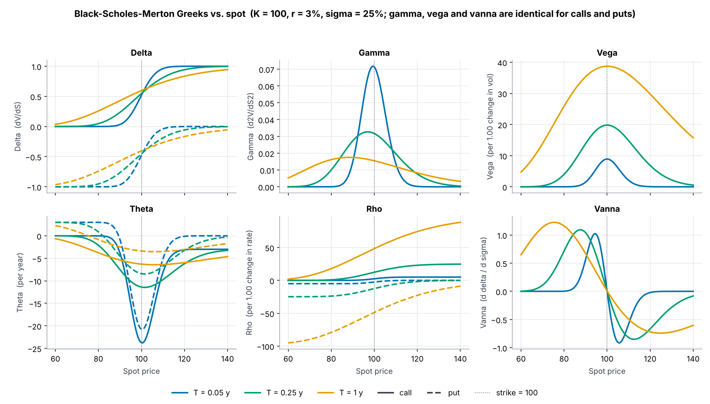

# greekscope

[](https://github.com/rishitmpatel/greekscope/actions/workflows/tests.yml)


Option pricing, Greeks, implied volatility and strategy analysis in pure numpy/scipy.

**Live playground:** https://rishitmpatel.github.io/greekscope/ — the same maths ported to a single dependency-free web page.



## What's inside

| Module | What it does |
|---|---|
| `bsm` | Black-Scholes-Merton prices with continuous dividend yield, vectorised over numpy arrays |
| `greeks` | Analytic delta, gamma, vega, theta, rho, vanna, volga |
| `implied_vol` | Guarded Newton (Corrado-Miller start) with Brent fallback, solved on the OTM side of parity |
| `binomial` | Cox-Ross-Rubinstein tree, European and American exercise, vectorised induction |
| `montecarlo` | European MC with antithetic + control variates; arithmetic Asian with a geometric-Asian control variate |
| `heston` | Semi-analytic Heston (1993) using the stable "little Heston trap" characteristic function |
| `strategy` | Multi-leg strategies: payoff, mark-to-model P&L, aggregated Greeks, exact breakevens and max profit/loss |
| `surface` | Implied-vol surface from quotes, total-variance interpolation in time, smile extraction |
| `cli` | `greekscope price / iv / strategy` from the terminal |

## Install

```bash
git clone https://github.com/rishitmpatel/greekscope
cd greekscope
pip install -e ".[dev]"     # numpy + scipy; dev adds pytest and matplotlib
```

## Quick start

```python
import greekscope as gs

gs.bsm_price(100, 100, 1.0, 0.05, 0.20, "call")            # 10.450583572185565
gs.all_greeks(100, 100, 1.0, 0.05, 0.20, "put", q=0.02)     # dict of price + 7 Greeks

gs.implied_vol(10.45, S=100, K=100, T=1.0, r=0.05)          # 0.19998...

gs.crr_price(100, 100, 1.0, 0.05, 0.20, "put", american=True, steps=2000)   # 6.0900
gs.mc_price(100, 100, 1.0, 0.05, 0.20, seed=1)              # MCResult(price=10.446, std_error=0.006, ...)
gs.heston_price(100, 100, 1.0, 0.0, v0=0.04, kappa=1.5, theta=0.04, xi=0.3, rho=-0.7)  # 7.5403

ic = gs.iron_condor(100, 0.25, 0.05, 0.20, 85, 95, 105, 115)
ic.breakevens()      # [91.65, 108.35]
ic.max_profit(), ic.max_loss()
print(ic.summary())
```

Every price/Greek function broadcasts over numpy arrays, so a whole Greek-vs-spot curve is one call:

```python
import numpy as np
S = np.linspace(60, 140, 200)
gs.gamma(S, 100, 0.5, 0.05, 0.2)
```

## CLI

```text
$ greekscope price --S 100 --K 100 --T 1 --r 0.05 --sigma 0.2
Price      10.450584
Delta       0.636831
Gamma       0.018762
Vega       37.524035
Theta      -6.414028
...

$ greekscope price --S 100 --K 100 --T 1 --r 0.05 --sigma 0.2 --kind put --method american
$ greekscope iv --price 10.45 --S 100 --K 100 --T 1 --r 0.05
$ greekscope strategy iron-condor --S 100 --K1 85 --K2 95 --K3 105 --K4 115 --T 0.25 --r 0.05 --sigma 0.2
```

`python -m greekscope` works too.

## Conventions

- `S` spot, `K` strike, `T` years, `r` and `q` continuously compounded, `sigma` annualised.
- Vega and rho are per 1.00 change (divide by 100 for per vol/rate point). Theta is `-dV/dT`, per year.
- `T = 0` and `sigma = 0` return the deterministic limits, never NaN.
- Strategy quantities are signed (+ long, − short) in units of the underlying; pass `multiplier=` for contract sizes.

## How it's verified

308 tests (`python -m pytest -q`, about 6 s; `-m "not slow"` skips three Heston Monte Carlo checks):

- BSM reference values to 1e-10 and put-call parity across a grid
- Every Greek, including vanna and volga, against central finite differences (calls and puts, `q ≠ 0`)
- Implied vol round-trips for σ from 1% to 300%, strikes 50–200, expiries 0.05–5 years
- CRR converges to BSM; American put ≥ European; American call without dividends = European
- Monte Carlo lands within 3 standard errors of BSM, and the reported standard error is itself checked against run-to-run spread
- Heston: parity, the ξ → 0 limit equals BSM, agreement with an independent Lewis-formula implementation, and an Euler full-truncation simulation
- Strategy breakevens / max profit / max loss against closed forms (straddle, spreads, condor, covered call)



## Examples

```bash
python examples/payoff_diagrams.py   # docs/img/payoff_diagrams.png
python examples/greeks_vs_spot.py    # docs/img/greeks_vs_spot.png, greeks_strategies.png
python examples/convergence.py       # docs/img/convergence.png
python examples/vol_smile.py         # docs/img/vol_smile.png
```



## Limitations

Models, not markets. BSM assumes constant volatility and frictionless trading; Heston adds stochastic variance but no jumps. No discrete dividends, no market data feeds, no calibration routine (yet). Educational tool, not trading advice.

## Roadmap

- Heston calibration to a vol surface
- SABR and SVI smile fits
- Barrier and digital options
- Pull live NSE option chains (pairs with an Indian market data library)

## License

MIT
